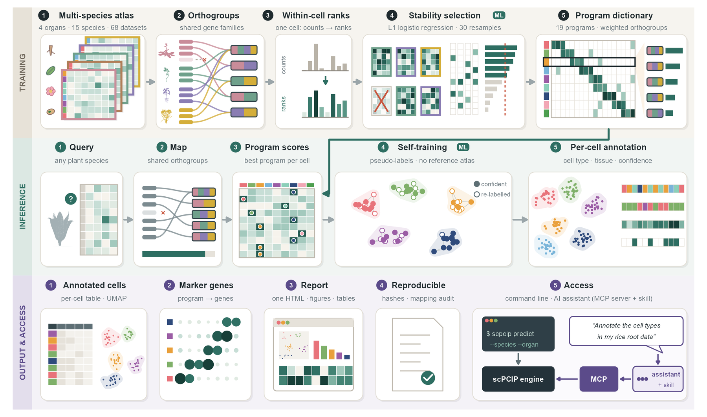
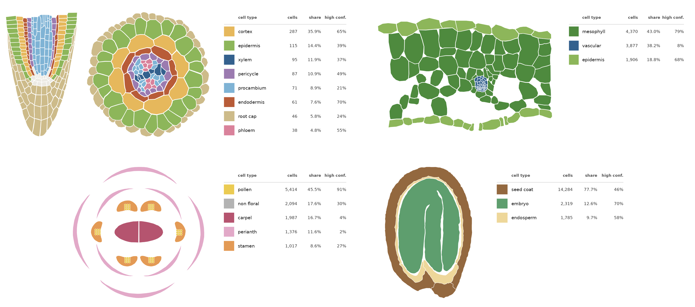
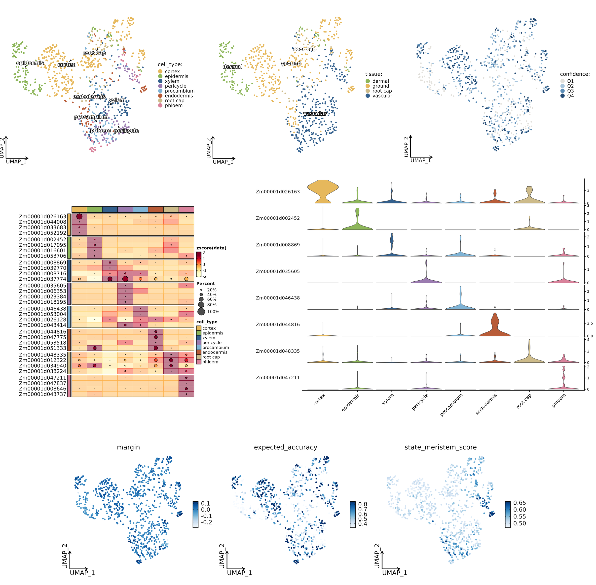

<div align="center">
<pre>
          _____   _____ _____ _____  
         |  __ \ / ____|_   _|  __ \ 
 ___  ___| |__) | |      | | | |__) |
/ __|/ __|  ___/| |      | | |  ___/ 
\__ \ (__| |    | |____ _| |_| |     
|___/\___|_|     \_____|_____|_|     
</pre>

**single-cell Plant Cell Identity Programs**

Cross-species cell-type annotation for plant single-cell RNA-seq: root, leaf, flower and seed, no reference atlas needed.

Version 1.0.0 · Python ≥ 3.11 · MIT licence · see [CHANGELOG.md](https://github.com/Shipeng-Yang/scPCIP/blob/main/CHANGELOG.md)

</div>

<p align="center">
  
</p>

**scPCIP** (single-cell Plant Cell Identity Programs) annotates plant single-cell RNA-seq data with cross-species
gene programs. Each cell type is described by a weighted set of orthogroups learned from many labelled plant atlases,
so a new dataset can be annotated without a reference atlas from the same species.

Cell-type names follow the **Plant Ontology of Cell Types (POCT)** (Chen et al., *Mol. Plant* 2026,
[doi:10.1016/j.molp.2025.12.025](https://doi.org/10.1016/j.molp.2025.12.025)). Root labels from every training atlas
were mapped onto POCT before training, so the same root cell type carries the same name in every species; the eight
root types reported below are POCT types grouped into coarse classes. Leaf, flower and seed labels were mapped with
fixed tables to the classes listed below.

For every cell scPCIP reports one cell type, its tissue system, the program scores, a margin-based confidence
quartile with the accuracy measured for that quartile on held-out species, and (optionally) figures, marker tables
and a self-contained HTML report.

| Organ | Cell types | Tissue systems |
|---|---|---|
| root | epidermis, cortex, endodermis, pericycle, phloem, procambium, xylem, root cap (+ meristem state score) | dermal, ground, vascular, root cap |
| leaf | epidermis, mesophyll, vasculature (+ secondary xylem / phloem score) | dermal, ground, vascular |
| flower | pollen, stamen, carpel, perianth, non-floral | stamen, carpel, perianth, non-floral |
| seed | embryo, endosperm, seed coat | embryo, endosperm, seed coat |

Stem is not supported.

## Install

```bash
pip install scpcip
```

A new environment is recommended, because the dependencies are pinned to the versions the release was
validated with (for example `python -m venv scpcip_env` or `conda create -n scpcip python=3.12`). The development
version installs with `pip install "git+https://github.com/Shipeng-Yang/scPCIP.git"`.

Python >= 3.11. The gene -> orthogroup map (about 50 MB) is downloaded from the Hugging Face Hub on first use and
cached in `~/.cache/scpcip/<revision>/` (`scpcip fetch` downloads it now; `SCPCIP_FEATURE_MAP=/path/to/gene_to_feature.tsv`
uses a local copy).

The organ maps, UMAPs and marker heatmaps under [Output](#output) are drawn in R (SCP, Seurat, ggPlantmap). They are
made whenever `Rscript` with those packages is found; otherwise the run writes everything else. The Apptainer /
Singularity image in [`container/`](https://github.com/Shipeng-Yang/scPCIP/blob/main/container/README.md) has Python, R and all packages preinstalled:

```bash
apptainer run scpcip.sif predict --input root.h5ad --species "Oryza sativa" --organ root --out results/
```

## Run

The input is an AnnData `.h5ad` with raw counts and the gene IDs of the species' reference annotation as
`var_names`.

```bash
scpcip species                                   # species covered by the shipped gene map
scpcip predict --input root.h5ad --species "Oryza sativa" --organ root --out results/
scpcip predict --input sample.h5ad --species "Glycine max" --organ-key organ --out results/   # mixed organs
```

`--organ-key` names the `obs` column holding each cell's organ (or its sample, together with
`--organ-map sample_to_organ.tsv`); each organ part is annotated with its own dictionary.

The counts can be in `X`, in a `counts` layer or in `.raw` (as in h5ad files converted from Seurat, where `X` holds
log-normalised values); scPCIP finds them and says which it used. If no raw counts are present it warns and scores
`X` as given.

### Species not in the shipped map

Annotate the species' protein sequences with [eggNOG-mapper](https://github.com/eggnogdb/eggnog-mapper) (v2.1,
eggNOG 5 database) and turn the result into a gene map:

```bash
emapper.py -i proteins.faa --itype proteins -m diamond --tax_scope Viridiplantae -o my_species --cpu 16
scpcip build-map --annotations my_species.emapper.annotations --species "My species" --out my_species_map.tsv
scpcip predict --input data.h5ad --species "My species" --feature-map my_species_map.tsv --organ root --out results/
```

Protein ids such as `Gene01G000100.1` are reduced to gene ids (`Gene01G000100`) by removing a trailing isoform
number; use `--strip-regex` if your ids differ, or `--no-strip` if they already match the gene ids in the matrix.

From a clone of this repository, try the bundled example (800 maize root cells, GSE183171):

```bash
scpcip predict --input examples/maize_root_example.h5ad --species "Zea mays" --out example_out
```

## Reproducibility check for multi-sample data

When the input has a sample column (`sample`, `orig.ident`, `batch`, `library` or `replicate`, or `--sample-key`)
and a cluster column from an integration of the samples (`seurat_clusters`, `leiden`, `louvain`, `clusters`,
`cluster`, or `--cluster-key`), the report checks whether cells of the same cluster receive the same calls in every
sample. A clear disagreement (for example between biological replicates) is shown as a warning at the top of the
report and printed on the command line; the per-cluster numbers are in `<id>.sample_consistency.tsv`. Without an
integrated cluster column the check is not run: clusters computed on unintegrated samples cannot tell a real
disagreement from a batch effect.

## Use from Python

```python
import scanpy as sc
import pcip

adata = sc.read_h5ad("root.h5ad")                 # raw counts in X (or in a "counts" layer)
pcip.annotate(adata, species="Oryza sativa", organ="root")
adata.obs["scpcip_predicted_cell_type"]           # also scpcip_tissue_system, scpcip_confidence_quartile, ...
adata.obsm["scpcip_type_scores"]                  # cells x types
```

`pcip.annotate` takes the same options as `scpcip predict` (`organ_key`, `organ_map`, `feature_map`, `seed`; `out=`
plus `report=True` keeps the files and the HTML report) and gives identical results.

## Use from R / Seurat

Write the raw counts to `.h5ad` with the CRAN package `anndata` (it uses the Python `anndata` installed with scPCIP),
run `scpcip` and read the calls back:

```r
library(Seurat)
library(anndata)
counts <- LayerData(seu, assay = "RNA", layer = "counts")   # genes x cells
ad <- AnnData(X = Matrix::t(counts),
              obs = data.frame(row.names = colnames(counts)),
              var = data.frame(row.names = rownames(counts)))
ad$write_h5ad("query.h5ad")
system2("scpcip", c("predict", "--input", "query.h5ad", "--species", shQuote("Zea mays"),
                    "--organ", "root", "--out", "scpcip_out"))
pred <- read.delim("scpcip_out/query.predictions.tsv", row.names = "cell_id")
seu <- AddMetaData(seu, pred[colnames(seu), c("predicted_cell_type", "tissue_system", "confidence_quartile")])
```

If R does not find the Python environment where scPCIP is installed, set `RETICULATE_PYTHON` to its `python`.

## Output

Organ maps from the four example datasets (maize root, *Arabidopsis lyrata* leaf, *Arabidopsis thaliana* flower,
soybean seed): each tissue is coloured by the cell type predicted for it, with cell counts, shares and the fraction of
high-confidence calls.

<p align="center">
  
</p>

The other figures, shown for the maize root example: UMAPs by cell type, tissue system and confidence quartile;
marker heatmap and violins of each type's top program genes (your gene ids); per-cell margin, expected accuracy and
developmental-state score.

<p align="center">
  
</p>

| File | Content |
|---|---|
| `<id>.predictions.tsv` | per cell: `predicted_cell_type`, `tissue_system`, `margin`, `confidence_quartile`, `expected_accuracy`, developmental-state scores (root: `state_meristem_score`) |
| `<id>.type_scores.tsv` | per cell and type: corrected program score |
| `<id>.predict_report.json` | settings, gene mapping rate, counts, versions |
| `<id>.report.html` | one self-contained page with every figure and table below (open it in a browser) |
| `figures/*.png`, `figures/*.pdf` | UMAP by cell type, by tissue system and by confidence; composition split by confidence; program-score heatmap; marker dot plot labelled with your gene ids; margin per type; developmental-state score |
| `<id>.scPCIP_figures/` | the figures above (PNG + PDF) and `scPCIP_marker_genes_plotted.tsv`; drawn when R with SCP, Seurat and ggPlantmap is available (all in the container image, see `container/`), also with `scpcip plot` after a run |
| `<id>.markers.tsv` | per type: ranked program orthogroups with your member genes and in-type vs rest detection / fold change |
| `<id>.composition.tsv`, `confidence.tsv`, `reliability.tsv`, `group_scores.tsv`, `umap.tsv` | the numbers behind the figures |

The figures and report are written by default; `--no-report` writes the prediction tables only (faster on very
large datasets).

Every cell receives a type; the tool does not abstain. Use `confidence_quartile` / `expected_accuracy` to decide
which calls to trust: quartile 1 cells are tentative, and a cell type absent from the sample can still be assigned
to a few low-confidence cells.

## Limitations

- **Strong sample structure.** The default refinement step votes within clusters of the query. In a time course or a
  dataset with strong batches, those clusters can follow the samples and the refinement then exaggerates differences
  between samples. When the reproducibility check warns, compare with a run that turns refinement off: copy the
  shipped config (`src/pcip/data/configs/predict_root.yaml`), set `refine: none` and
  `dictionary: dictionaries/root.yaml`, and pass it with `--config`. On labelled root datasets turning
  refinement off lowers accuracy, so keep the default when the check passes.
- **Distant species.** `expected_accuracy` is measured on species held out of training. For a lineage with no close
  relative in the training data, per-cell calls are weaker and their accuracy cannot be checked on the data itself;
  prefer group-level summaries (composition, trends) and the high-confidence quartiles.

## Versions and updates

scPCIP versions are numbered `MAJOR.MINOR.PATCH`. Which number moves depends on what a release changes:

| Release | Example | What changes | Your earlier results |
|---|---|---|---|
| Patch | 1.0.0 → 1.0.1 | bug fixes, speed, messages, documentation | reproduced exactly (checked on the bundled examples before release) |
| Minor | 1.0 → 1.1 | species added to the gene → orthogroup map; new optional outputs or options | reproduced exactly for species already covered |
| Major | 1.x → 2.0 | dictionaries retrained (for example with atlases from more species), organs added, output columns changed | may differ; held-out accuracy of the new dictionaries is given in the changelog |

**What a version fixes.** Each version ships its dictionaries inside the package and reads the gene → orthogroup map
from a fixed commit of the Hugging Face repository, so the same version always gives the same predictions.
`scpcip --version` lists both:

```text
scpcip 1.0.0
  dictionaries: root, leaf, flower, seed
  gene -> orthogroup map: huggingface.co/shipengyang/scPCIP @ 7eaec1bb7081
```

Every run records the same information (scPCIP version, dictionary name and SHA-256, map revision and SHA-256) in
`<id>.predict_report.json`. The dictionaries change only in a major release.

**More species.** Species reach scPCIP in two ways:

1. *Annotating a new species.* The dictionaries work on orthogroups, so a species only needs a gene → orthogroup
   table. You can build one now with `scpcip build-map` and pass it with `--feature-map`. Species added to the shipped
   map arrive in a minor release; the dictionaries, and so the results for every other species, stay the same.
2. *Training on a new species.* Labelled atlases from new species are used to retrain the dictionaries. This changes
   the programs and is released as a new major version, with the held-out evaluation repeated and reported in the
   changelog. Earlier major versions stay installable.

**Updating or pinning a version.**

```bash
pip install -U scpcip            # latest release
pip install scpcip==1.0.0     # a fixed version, e.g. for a paper
```

The map for each version is cached separately in `~/.cache/scpcip/<revision>/`, so versions can be switched without
re-downloading. Changes are listed in [CHANGELOG.md](https://github.com/Shipeng-Yang/scPCIP/blob/main/CHANGELOG.md). For a publication, cite the version you used.

## Use from an AI assistant (MCP server and agent skill)

`integrations/` lets an AI assistant run scPCIP for you and explain the result. The server uses the open Model Context
Protocol (MCP), so it works with any assistant that supports MCP servers over stdio: Claude Code, Claude Desktop,
Codex, Gemini CLI, Cursor, VS Code (GitHub Copilot), Windsurf, Cline and others. It has been tested with Claude Code,
Claude Desktop and Codex. It has two parts, which can be used together or separately:

| Part | File | What it does |
|---|---|---|
| MCP server | `integrations/mcp/scpcip_mcp_server.py` | gives the assistant four tools: `scpcip_supported` (organs and species), `scpcip_inspect_input` (cells, genes, example gene IDs, metadata columns of an `.h5ad`), `scpcip_annotate` (runs the annotation and returns the composition, confidence and report path), `scpcip_markers` (top marker genes per predicted type) |
| Agent skill | `integrations/skills/scpcip/SKILL.md` | tells the assistant how to use scPCIP correctly: ask for species and organ instead of guessing, check the input first, never present low-confidence calls as certain, and how to report the result |

**1. Install the MCP server** in its own small environment (scPCIP itself stays in its own environment; the server
calls it through `SCPCIP_PYTHON`):

```bash
python -m venv scpcip_mcp_venv
scpcip_mcp_venv/bin/pip install "mcp==2.3.0"
```

**2. Register it with your assistant.** Replace the three paths with yours.

Claude Code:

```bash
claude mcp add scpcip \
  --env SCPCIP_PYTHON=/path/to/scpcip_env/bin/python \
  -- /path/to/scpcip_mcp_venv/bin/python /path/to/scPCIP/integrations/mcp/scpcip_mcp_server.py
```

Claude Desktop, Gemini CLI, Cursor, Windsurf, Cline and other clients that read an `mcpServers` JSON configuration:

```json
{
  "mcpServers": {
    "scpcip": {
      "command": "/path/to/scpcip_mcp_venv/bin/python",
      "args": ["/path/to/scPCIP/integrations/mcp/scpcip_mcp_server.py"],
      "env": {"SCPCIP_PYTHON": "/path/to/scpcip_env/bin/python"}
    }
  }
}
```

Where that JSON goes:

| Assistant | Configuration file |
|---|---|
| Claude Desktop | `claude_desktop_config.json` (Settings > Developer > Edit Config) |
| Gemini CLI | `~/.gemini/settings.json` |
| Cursor | `~/.cursor/mcp.json` (all projects) or `.cursor/mcp.json` (one project) |
| Windsurf | `~/.codeium/windsurf/mcp_config.json` |
| Cline | `cline_mcp_settings.json` (MCP Servers > Configure) |

VS Code with GitHub Copilot (`.vscode/mcp.json`; note the top-level key `servers` and the `type` field):

```json
{
  "servers": {
    "scpcip": {
      "type": "stdio",
      "command": "/path/to/scpcip_mcp_venv/bin/python",
      "args": ["/path/to/scPCIP/integrations/mcp/scpcip_mcp_server.py"],
      "env": {"SCPCIP_PYTHON": "/path/to/scpcip_env/bin/python"}
    }
  }
}
```

Codex (`~/.codex/config.toml`):

```toml
[mcp_servers.scpcip]
command = "/path/to/scpcip_mcp_venv/bin/python"
args = ["/path/to/scPCIP/integrations/mcp/scpcip_mcp_server.py"]
env = { SCPCIP_PYTHON = "/path/to/scpcip_env/bin/python" }
```

**3. Add the skill.** For Claude Code, copy the folder into your skills directory:

```bash
mkdir -p ~/.claude/skills && cp -r integrations/skills/scpcip ~/.claude/skills/
```

For other assistants, add the content of `SKILL.md` to the file the assistant reads its instructions from:
`AGENTS.md` (Codex and other tools that read it), `GEMINI.md` (Gemini CLI), a rule in `.cursor/rules/` (Cursor),
`.github/copilot-instructions.md` (GitHub Copilot) or `.windsurfrules` (Windsurf).
The skill also works without the MCP server: the assistant then runs the `scpcip` command line.

**4. Ask in plain language**, for example:

> Annotate /data/rice_root.h5ad with scPCIP. It is rice (Oryza sativa) root. Show me the cell-type composition,
> how confident the calls are, and the top marker genes of the endodermis.

The assistant inspects the file, runs the annotation, and reports the composition, the share of low-confidence
cells and the path to the HTML report.

**Check the installation** end to end:

```bash
SCPCIP_PYTHON=/path/to/scpcip_env/bin/python \
  scpcip_mcp_venv/bin/python integrations/mcp/smoke_test.py examples/maize_root_example.h5ad "Zea mays" root ./scpcip_smoke
```

The start-up banner shown in a terminal and in interactive Python can be switched off with `SCPCIP_NO_BANNER=1`.

## Test

```bash
pip install pytest && pytest tests/
```

## Citation

Yang, S., Si, C., Wu, Y., Sun, Z., Yao, C., Sun, X., Wang, L., Li, W. & Zhong, Q. scPCIP: cross-species annotation of plant cell types with conserved gene programs. *bioRxiv* (2026).

`CITATION.cff` holds the same reference (GitHub shows it under "Cite this repository").

## License

MIT
